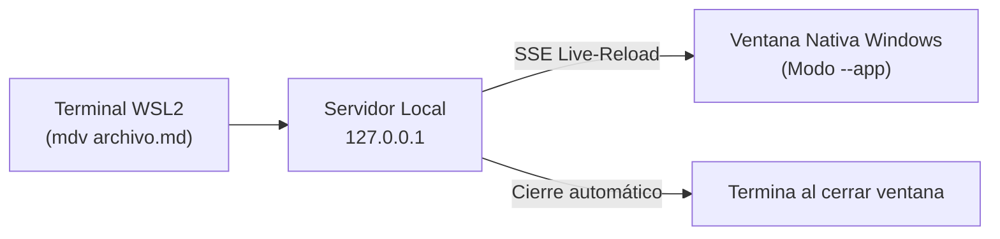
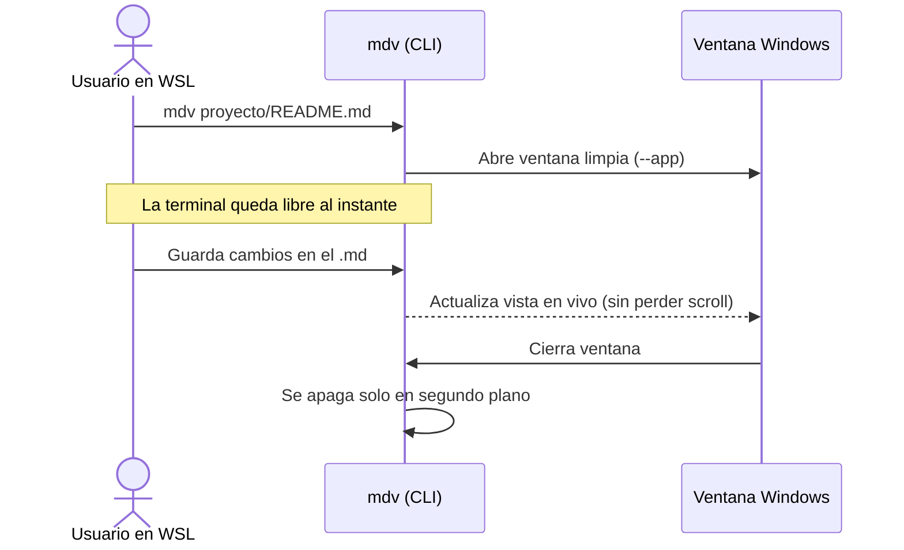

# Bienvenido a `mdv`

Un visor ligero de Markdown lanzado desde tu consola WSL2, renderizado con tipografía nítida en una **ventana limpia de Windows** y con soporte real para los componentes extendidos que `leaf` o `inlyne` no pueden mostrar.

> [!TIP] Atajos estilo Vim + Live-Reload activo
> Presiona **`?`** en cualquier momento para ver todos los atajos: `j`/`k` (o `5j`), `d`/`u`, `gg`/`G`, `]]`/`[[` entre secciones, **`h`/`l`** para mover el carrusel en pantalla, **`/`** + `n`/`N` para buscar, `t` índice, `c` rotar tema y `q` cerrar. Si editas este archivo en Vim o VS Code, se actualiza en vivo conservando tu posición.

---

## 1. Carrusel interactivo (`carousel`)

Haz clic en las flechas `←` / `→`, en los indicadores inferiores o usa las teclas de dirección para recorrer las diapositivas:

````carousel
<!-- slide: 1. Antes vs Después en Código -->
### Refactorización asíncrona

```typescript
// Procesamiento paralelo limpio con tipado estricto
export async function syncWorkspace(files: string[]): Promise<number> {
  const results = await Promise.all(
    files.map((file) => renderMarkdown(file, { liveReload: true }))
  );
  return results.filter((r) => r.ok).length;
}
```

> [!NOTE] Los bloques de código dentro del carrusel conservan el resaltado de sintaxis y el botón de **Copiar**.

<!-- slide: 2. Diagrama Mermaid dentro del Carrusel -->
### Flujo de arquitectura en WSL2



<!-- slide: 3. Comparativa de Visores -->
### Comparativa rápida

| Función | `leaf` | `inlyne` | **`mdv`** |
| :--- | :---: | :---: | :---: |
| Tipografía nativa de Windows | Consola | Tosca en WSLg | **Nítida (DirectWrite)** |
| Bloques ````carousel` | No | No | **Sí (Interactivo)** |
| Diagramas Mermaid vectoriales | Solo ASCII | No | **Sí (SVG + Zoom)** |
| Alertas `[!NOTE]` / `[!WARNING]` | Básico | No | **Sí (Completas)** |
| Fórmulas LaTeX (`$...$`) | Básico | No | **Sí (KaTeX)** |
````

---

## 2. Diagramas Mermaid con modo Ampliar

Pasa del ASCII limitado de la terminal a gráficos vectoriales reales que se adaptan automáticamente al tema oscuro o claro (prueba el botón **Ampliar** arriba a la derecha):



---

## 3. Alertas y Bloques Desplegables

> [!IMPORTANT] Cero procesos colgados
> Cuando lanzas `mdv archivo.md`, tu terminal queda libre enseguida; y apenas cierras la ventana del visor, el servidor local detecta la desconexión y se cierra automáticamente.

> [!WARNING] Archivos locales e imágenes
> Todas las rutas relativas (`./diagrama.svg`) y enlaces `file://` de tus artefactos se resuelven localmente sin subir nada a internet.

<details>
<summary>Ver todos los comandos disponibles de <code>mdv</code></summary>

```bash
# Abrir un archivo en ventana limpia tipo app
mdv notas.md

# Abrir una carpeta completa (habilita el panel izquierdo de archivos)
mdv ./docs

# Pasar contenido por tubería (igual que leaf)
cat README.md | mdv

# Abrir en una pestaña normal de tu navegador
mdv -b notas.md
```

</details>

---

## 4. Fórmulas Matemáticas (KaTeX)

Soporta expresiones en línea como $E = mc^2$ o complejidad $\mathcal{O}(n \log n)$, así como bloques completos:

$$
\mathcal{L}(\theta) = -\frac{1}{N} \sum_{i=1}^{N} \left[ y_i \log \hat{y}_i + (1 - y_i) \log(1 - \hat{y}_i) \right]
$$
