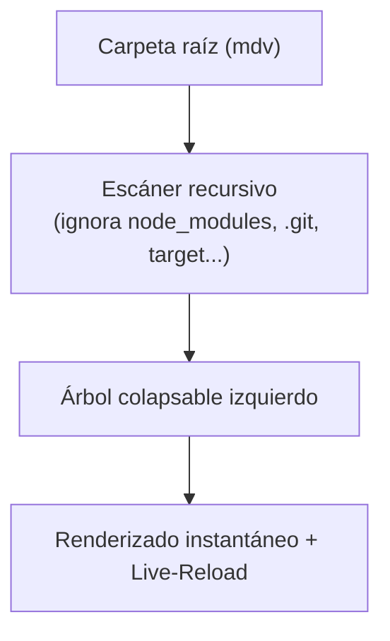

# Arquitectura Interna de `mdv`

Este archivo vive dentro de la subcarpeta `docs/` para demostrar el **explorador recursivo de carpetas**.

- Puedes volver al documento raíz desde el árbol izquierdo o pulsando **`[f`** / **`]f`**.
- También puedes presionar **`Ctrl+P`** para filtrar cualquier `.md` por nombre o ruta relativa y abrirlo con `Enter`.

